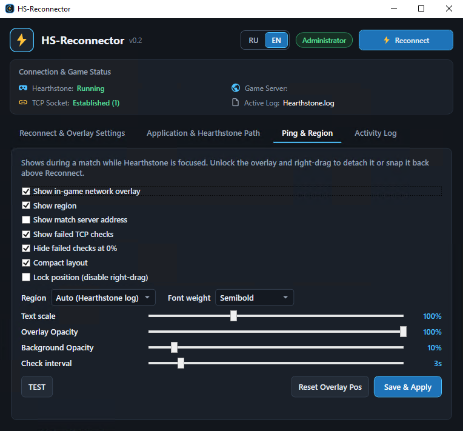

# Ping & Region

[Русский](PING.ru.md) · [Back to README](README.md)

The network overlay is off by default. Open **Ping & Region**, enable **Show in-game network overlay**, and click **Save & Apply**. The overlay appears when a match server is known and Hearthstone is in focus.

## What the numbers mean

- **PING** measures the time to open a separate TCP connection to the current match server. The check runs every 3 seconds by default and can be set to 2–10 seconds. The display reserves three digits, hides leading zeros, and caps the displayed value at 999 ms.
- **Region** comes from the current Hearthstone log in Auto mode. The overlay displays EU, US, ASIA or CHINA. If the log has no supported region marker, the value is shown as a dash and you can select a region manually.
- **Failed TCP checks** shows the percentage of failed connection attempts among the last 10 checks. This measures failed checks. Actual packet loss on the game connection is a separate metric.

Each check opens and closes a TCP connection. At the default interval, that is up to 20 attempts per minute while the overlay is active. A gaming accelerator may route the game and the probe differently, so the displayed latency may differ from the game's connection.

## Appearance and position

Choose compact or multiline layout, font weight, text scale, overlay opacity and background opacity. You can also show the server address and hide failed checks at 0%.

The overlay starts above the reconnect button and follows it when moved. Unlock its position and right-drag to detach it. Move either overlay close to the other to snap them together again, or disable **Snap Ping and Reconnect overlays together** on either overlay tab to keep them independent. **Reset Overlay Pos** restores the default position above the reconnect button.

Press **TEST** once for a 20-second preview. Adjustments update the preview and restart the timer. Press it again to simulate high latency, a failed check and recovery. Press it a third time to stop the simulation. TEST uses sample data.
