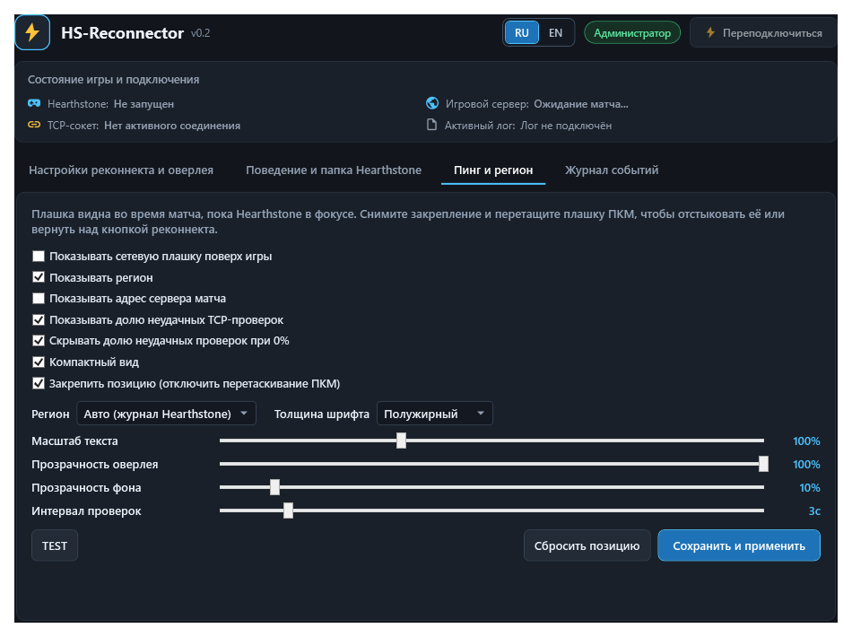

# Пинг и регион

[English](PING.md) · [Вернуться в README](README.ru.md)

По умолчанию плашка выключена. На вкладке **Пинг и регион** включите **Показывать сетевую плашку поверх игры** и нажмите **Сохранить и применить**. Плашка появится, когда определён сервер матча и Hearthstone находится в фокусе.

## Что показывают значения

- **PING** показывает время отдельного TCP-подключения к текущему серверу матча. По умолчанию проверка выполняется каждые 3 секунды, интервал можно настроить от 2 до 10 секунд. Поле занимает три позиции, ведущие нули скрыты, максимальное отображаемое значение — 999 мс.
- **Регион** в режиме **Авто** определяется по журналу текущей сессии Hearthstone. Поддерживаются EU, US, ASIA и CHINA. Если подходящей записи нет, отображается прочерк и регион можно выбрать вручную.
- **Неудачные TCP-проверки** показывают долю неудачных попыток подключения за последние 10 проверок. Потеря пакетов в игровом соединении — отдельный показатель.

Каждая проверка открывает и закрывает TCP-соединение. При стандартном интервале это до 20 попыток в минуту, пока плашка активна. Игровой ускоритель может направлять трафик игры и проверки по-разному, поэтому показанная задержка может отличаться от задержки игрового соединения.

## Внешний вид и позиция

Можно выбрать компактный или многострочный вид, жирность и масштаб текста, прозрачность плашки и фона. Адрес сервера можно вывести отдельно. Показатель неудачных проверок можно скрывать при 0%.

По умолчанию плашка находится над кнопкой реконнекта и перемещается вместе с ней. Чтобы отстыковать её, снимите закрепление и перетащите плашку правой кнопкой мыши. Чтобы примагнитить плашки обратно, подвиньте одну к другой, или отключите общую настройку **Примагничивать плашку пинга и кнопку реконнекта** на любой вкладке оверлеев, чтобы двигать их независимо. **Сбросить позицию** возвращает плашку в стандартную позицию над кнопкой реконнекта.

Первое нажатие **TEST** показывает плашку на 20 секунд. Правки видны сразу и обновляют таймер. Второе нажатие имитирует высокий пинг, неудачную проверку и восстановление. Третье останавливает тест. В тесте используются демонстрационные значения.
