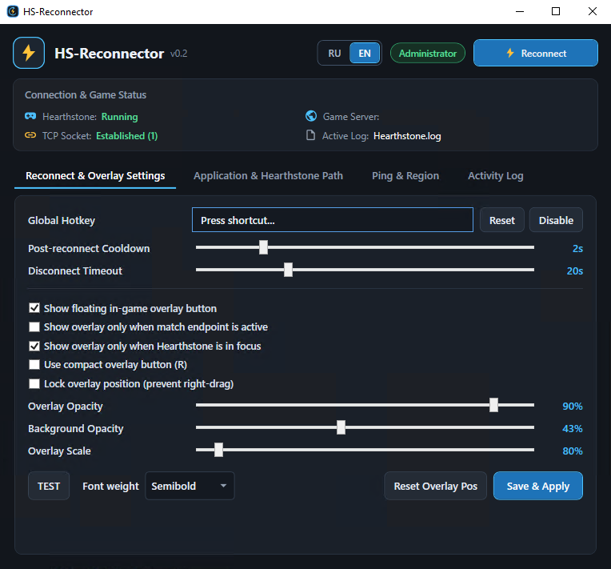
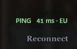

# HS-Reconnector

[**Русский**](README.ru.md) · [**Download for Windows x64**](https://github.com/testd1111/HS-Reconnector/releases/latest)

A standalone Windows app for reconnecting to your current Hearthstone match with a hotkey or an in-game button.

> Hearthstone Deck Tracker is ending plugin support on November 30, 2026. I made HS-Reconnector a standalone app so reconnecting can keep working independently of HDT. [HearthSim announcement](https://help.hearthsim.net/en/articles/18470784-what-s-changing-about-plugins-in-hdt)

## Getting started

1. Download and extract the Windows x64 ZIP from [Releases](https://github.com/testd1111/HS-Reconnector/releases/latest).
2. Run `HS-Reconnector.exe` and approve the administrator prompt. Administrator access is required to reset the active game connection.
3. During a match, press **Ctrl+Alt+F10** or click the overlay button to reconnect.

Requires Windows 10 (1803+) or Windows 11, x64. The app detects Hearthstone automatically and lets you customize the global hotkey and the overlay.

## Ping & Region

The optional in-game overlay shows match-server latency and region. Enable it under **Ping & Region**. See [how it works and how to configure it](PING.md).

[Build and test instructions](BUILD_AND_INSTALL.md)

[MIT License](LICENSE)

## Download

 
