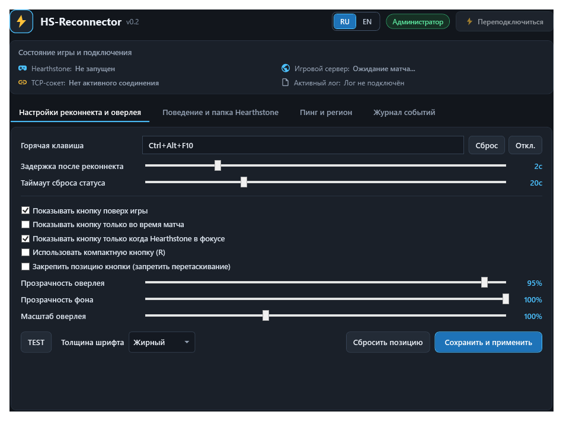
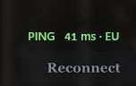

# HS-Reconnector

[**English**](README.md) · [**Скачать для Windows x64**](https://github.com/testd1111/HS-Reconnector/releases/latest) · [**SHOW PING**](PING.ru.md)

Отдельная программа для Windows, которая позволяет переподключиться к текущему матчу Hearthstone по горячей клавише или кнопкой поверх игры.

> С 30 ноября 2026 года Hearthstone Deck Tracker прекращает поддержку плагинов. Я вынес переподключение в отдельную программу, чтобы оно продолжало работать независимо от HDT. [Объявление HearthSim](https://help.hearthsim.net/en/articles/18470784-what-s-changing-about-plugins-in-hdt)

## Как пользоваться

1. Скачайте ZIP для Windows x64 из [раздела релизов](https://github.com/testd1111/HS-Reconnector/releases/latest) и распакуйте его.
2. Запустите `HS-Reconnector.exe` и подтвердите запрос прав администратора. Эти права нужны для сброса активного игрового соединения.
3. Во время матча нажмите **Ctrl+Alt+F10** или кнопку поверх игры, чтобы переподключиться.

Требуется Windows 10 (1803+) или Windows 11, x64. Программа автоматически находит Hearthstone и позволяет настроить горячую клавишу и кнопку поверх игры.

**Совместимость с игровыми ускорителями.** Переподключение может не сработать, если программа для снижения пинга или игровой ускоритель перенаправляет трафик Hearthstone через прокси. HS-Reconnector должен найти TCP-соединение с сервером матча, принадлежащее процессу Hearthstone. Если переподключение не срабатывает, попробуйте исключить Hearthstone из ускорителя или временно отключить ускоритель.

## Пинг и регион

Дополнительная плашка показывает задержку до сервера матча и регион. Её можно включить на вкладке **Пинг и регион**. Подробнее о [работе и настройке плашки](PING.ru.md).

[Инструкция по сборке и проверкам на английском](BUILD_AND_INSTALL.md)

[Лицензия MIT](LICENSE)
